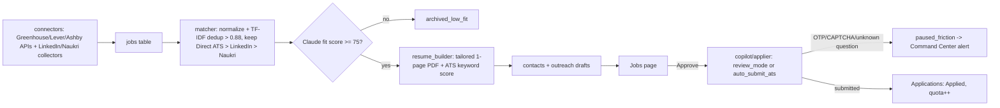

# laa-pi: local-first AI job search, resume tailoring and application copilot

   

laa-pi finds jobs, scores how well you fit each one, writes a tailored one-page resume, and helps you apply, all from your own machine. You stay in the loop: it never stores portal passwords, never gets past an OTP or CAPTCHA on its own, and never sends outreach for you.

**What it does**
- **Discovers jobs** from the Greenhouse, Lever and Ashby board APIs, plus LinkedIn and Naukri collectors driven by Playwright, then dedupes them with TF-IDF.
- **Scores fit** with an LLM (Claude, DeepSeek or any OpenAI-compatible API) against a weighted rubric. With no key it falls back to a deterministic heuristic mode.
- **Builds resumes that can't invent anything**: the LLM only selects and orders facts from your profile, and every rendered string is checked against it before WeasyPrint writes the PDF.
- **Fills applications** with field mapping and ATS adapters, pausing on any friction. A mobile-first Streamlit dashboard, a scheduler and a one-image Docker deploy (noVNC browser view behind Caddy) round it out.

**Tech stack:** Python 3.12 · Streamlit · SQLAlchemy and SQLite (WAL) · Pydantic · Playwright · Anthropic SDK and httpx · scikit-learn · RapidFuzz · WeasyPrint and Jinja2 · APScheduler · Docker, supervisord, Caddy and noVNC · pytest and Ruff · uv

Streamlit + SQLite + Playwright + Claude. Everything runs on your machine; the only secret is an Anthropic API key.

## Guardrails (enforced in code, not just documented)

| Guardrail | Where |
|---|---|
| Per-platform daily caps (LinkedIn 20 / Naukri 25 / Direct ATS 30) and 15-45 s humanized delays | `core/quota.py`, `config/config.yaml: quotas` |
| Execution windows; scheduler pauses the apply job for the day when caps are hit | `scheduler.py`, `pipeline/runner.py` |
| Persistent browser profile, `headless=False`, manual login once; no portal passwords anywhere | `copilot/browser.py`, `.env.example` |
| Pause on OTP / CAPTCHA / login wall / unknown screening question, with screenshot + dashboard alert | `copilot/friction.py`, `copilot/applier.py` |
| LinkedIn and Naukri are never auto-submitted; `auto_submit_ats` only on verified Greenhouse/Lever/Ashby forms with every required field mapped at confidence >= 0.90 | `copilot/applier.py`, `copilot/ats/*` |
| Outreach is copy-only; `outreach.auto_send: true` fails config validation | `core/settings.py`, `ui/outreach_hub.py` |
| Zero-hallucination resumes: the LLM only *selects and orders* profile facts by index; every rendered string is verified against `data/master_profile.json` before the PDF is written | `engine/resume_builder.py` (`verify_against_profile`) |
| Fit scoring: Claude gets a deterministic local evidence block; any skill it names that is not literally in the profile and the JD is dropped | `engine/matcher.py` |

## Setup

```bash
# 1. toolchain (Python 3.12 via uv; WeasyPrint needs pango/cairo -> brew install pango cairo)
uv sync --extra dev
uv run playwright install chromium

# 2. secrets: an AI key (Anthropic, DeepSeek, RouterPlus, or any OpenAI-compatible API)
cp .env.example .env            # or set the key later in Settings > AI
# without a key the system still runs in deterministic "heuristic mode" (scores, resumes, outreach via local rules)

# 3. your facts
#   data/master_profile.json is the single source of truth and is gitignored (it holds your contact details and CTC).
#   Start from the committed example:  cp data/master_profile.example.json data/master_profile.json
#   then fill in your basics, experience bullets, skills, current_ctc_lpa / expected_ctc_lpa and links.
#   config/target_companies.csv lists Greenhouse/Lever/Ashby boards (company, ats_type, board_token, careers_url, priority).

# 4. run
uv run streamlit run app.py     # dashboard
uv run python scheduler.py      # optional: cron runner (09:00 discovery, 10:30 + 15:30 apply batches, Mon-Fri IST)
```

First time: open the dashboard, **Settings > Connections > Log in** for LinkedIn and Naukri. A Chromium window with the
persistent profile (`data/browser_profile/`) opens; sign in by hand (including any OTP). Cookies persist for future runs.
The AI key can also be set in **Settings > AI** (stored in `data/secrets.json`, 0600, shown only as its last 4 characters).

## Daily flow



The dashboard is mobile first (top navigation, cards, sticky action bar) and centered on desktop:

1. **Home**: profile card, live status (scheduler, browser, AI, LinkedIn / Naukri sessions), a "needs your action"
   list linking to the right page, today's quotas and execution window, the pipeline funnel and quick actions.
2. **Jobs**: cards sorted by fit (filters: to review, approved, scored, low fit, applied, skipped). Open one for the
   rubric breakdown, tailored PDF and highlighted JD, then **Approve** (queued for the scheduled apply batch),
   **Apply now** (copilot in a separate process), **Skip** or **Mark applied**.
3. **Copilot** (`python -m copilot.applier --job-id <id>`): opens the job in the persistent browser, maps form fields
   to `application_defaults` / `screening_qa_bank` / approved answers, uploads the tailored PDF, then
   - `review_mode`: pauses before Submit. Click Submit yourself in the browser (detected automatically) or press
     "Approve submit" in the Command Center. The copilot polls for up to 15 minutes.
   - `auto_submit_ats`: submits only on Greenhouse/Lever/Ashby when every required field is mapped with confidence >= 0.90.
4. **Applications**: status tiles, cards on phones, an editable table on desktop (status, notes, follow-up date),
   auto-ghosting after 14 days, CSV export.
5. **Outreach**: recruiter connection note (< 300 chars), email/InMail (< 120 words), peer referral request
   (< 100 words), each quoting one verbatim `impact_metric` from your profile. Copy, send it yourself, mark sent.
6. **Command Center**: browser collection for LinkedIn / Naukri (start, stop keeping fetched jobs, live progress),
   job-board fetch, score fetched jobs, copilot sessions waiting on you (submit approval or friction, with screenshot
   and filled fields), screening questions to answer, recent runs.
7. **Scheduler**: alive / heartbeat, pause or resume each job or everything, run now, edit the cron times, log tail.
8. **Settings**: profile summary and upload, portal connections (log in, check now), AI key, and guardrails
   (titles, locations, experience band, fit threshold, daily caps, delays, execution windows, ATS submit mode).
   Edits are saved to `data/settings_overrides.yaml` on top of `config/config.yaml`; the scheduler reloads them.

Only one process opens the browser profile at a time (`data/exports/browser.lock`); collection, copilot, login and
connection checks wait for each other instead of colliding.

## Repository layout

```
app.py / scheduler.py        Streamlit entry, APScheduler runner
config/config.yaml           all tunables (search, caps, windows, rubric, copilot modes, field map, cron)
config/target_companies.csv  direct ATS boards to poll
core/                        settings, profile validator, models, SQLite schema/repository, Claude wrapper, quota
connectors/                  greenhouse / lever / ashby (HTTP JSON), linkedin / naukri (Playwright)
engine/                      matcher (dedup + fit), resume_builder (WeasyPrint), contacts, outreach, templates/
copilot/                     browser session, friction detectors, field mapper, applier, ats/ adapters
pipeline/                    discovery orchestration and run entrypoints
ui/                          dashboard pages (home, jobs, applications, outreach, command_center, scheduler_page, settings_page)
deploy/                      Caddyfile, supervisord.conf, entrypoint.sh for the Docker image
tests/                       pytest suite (no network, no browser; fixtures for the three ATS APIs)
data/                        master_profile.example.json (committed); master_profile.json (yours), jobs.db, resumes/, screenshots/, browser_profile/ (gitignored)
```

## Configuration highlights (`config/config.yaml`)

- `search.*`: titles, experience band, locations, excluded title keywords and companies (defaults mirror `application_defaults`).
- `matching.fit_threshold` (75) and `matching.rubric` weights (must sum to 100).
- `quotas.daily_caps`, `quotas.human_delay_seconds`, `quotas.execution_windows`.
- `copilot.default_mode_by_platform`: switch `direct_ats` to `auto_submit_ats` once you trust the field mapping.
- `copilot.profile_field_map`: regex on form label -> dotted path into `master_profile.json`.
- `resume.bullets_per_role`, `resume.max_skills_listed`, page size/margins.
- `scheduler.discovery_cron`, `scheduler.apply_cron` (5-field crontab, in `app.timezone`).

## Deploy (Docker, runs anywhere)

One image runs everything under supervisord: Streamlit, the scheduler, a real headed Chromium on a virtual display
(Xvfb), and noVNC so you can see and drive that browser from your phone. Caddy serves a single port behind a password:
`/` is the dashboard, `/browser/` is the live browser view (log in to LinkedIn / Naukri there, watch the copilot,
solve an OTP or CAPTCHA by hand). Everything that must survive restarts lives in `/app/data` (DB, browser profile with
your sessions, resumes, settings, AI key), so mount a volume there.

```bash
APP_PASSWORD='pick-a-strong-one' docker compose up -d --build
# open http://localhost:8080  (user: laa, or set APP_USER)
```

| Variable | Required | Purpose |
|---|---|---|
| `APP_PASSWORD` | yes | Dashboard + browser view password (the container refuses to start without it). This is not a portal password. |
| `APP_USER` | no | Login name, default `laa` |
| `PORT` | no | Listen port, default 8080 (Railway sets it) |
| `ANTHROPIC_API_KEY` / `DEEPSEEK_API_KEY` / `TM_API_KEY` | no | Or set the key later in Settings > AI. `TM_API_KEY` is a RouterPlus key (`tm_vk_…`). |

Where to host it (free first):

- **Your own machine + Tailscale** (free, recommended): residential IP, so LinkedIn / Naukri treat it like you.
  Run `docker compose up -d`, then reach `http://<machine>.<tailnet>.ts.net:8080` from your phone.
- **Oracle Cloud Always Free** (free): an Ampere A1 Flex VM (2 OCPU / 12 GB on Always Free) runs this image comfortably; the image
  builds for arm64 and amd64. Install Docker, clone, `docker compose up -d --build`, open port 8080 in the VCN
  security list (or use Tailscale instead of opening it). Oracle may reclaim Always Free VMs that stay almost idle for
  7 days; the daily scheduler and browser usually keep it above that, and upgrading the account to pay-as-you-go
  (still free within limits) removes the reclaim rule.
- **Railway Hobby** ($5/month): `railway.json` is included. Create a service from this repo, add a volume mounted at
  `/app/data`, set `APP_PASSWORD`, deploy. Railway's free plan sleeps idle services and has 0.5 GB RAM, which a
  scheduler plus Chromium cannot live with.
- Streamlit Community Cloud does not fit: it sleeps, wipes local files (the SQLite DB and browser sessions) and
  cannot run the scheduler or a browser.

Datacenter IPs (Oracle, Railway) are more likely to see LinkedIn / Naukri checks than a home connection. The copilot
pauses on those by design; finish them in the browser view.

Operate it: the **Scheduler** page shows heartbeat, next runs and the log and lets you pause, resume, run now or edit
times. `docker compose logs -f` shows every process; `docker compose restart` restarts them all. Back up by copying
the volume (`docker run --rm -v laa-pi_laa-data:/d -v "$PWD":/b alpine tar czf /b/laa-data.tgz -C /d .`).

## Tests

```bash
uv run pytest            # 103 tests (11 need a local Chromium and skip without it), run against data/master_profile.example.json: profile, connectors (mocked HTTP), search filters, dedup + scoring, resume PDF, outreach, field mapping, pipeline, browser run, submit detection, settings overrides, secrets, browser lock, scheduler control, every dashboard page
uv run ruff check .
```

## Notes and limits

- LinkedIn/Naukri selectors live in `connectors/linkedin.py`, `connectors/naukri.py`, `copilot/ats/*`. They are lists
  with fallbacks; if a portal redesign breaks a collector it fails soft (logs, returns what it found) rather than retrying aggressively.
- The copilot never bypasses friction. When it pauses you finish that step by hand; the session record keeps the field map and screenshot.
- Resume generation refuses to write a PDF containing any string not present in the profile (`HallucinationError`).
- `data/jobs.db` uses WAL mode so the dashboard, scheduler, and copilot subprocesses can share it.

## License

MIT © Akhilendra Singh
